<h1 align="center">Video Game Asset Creator</h1>

<p align="center">
  <strong>Type one sentence. Get a textured, rigged, animated 3D character or prop, ready for your game.</strong><br>
  Free, local, and private: everything runs on your own Windows PC. No accounts, no subscriptions, no uploads.
</p>

<p align="center">
  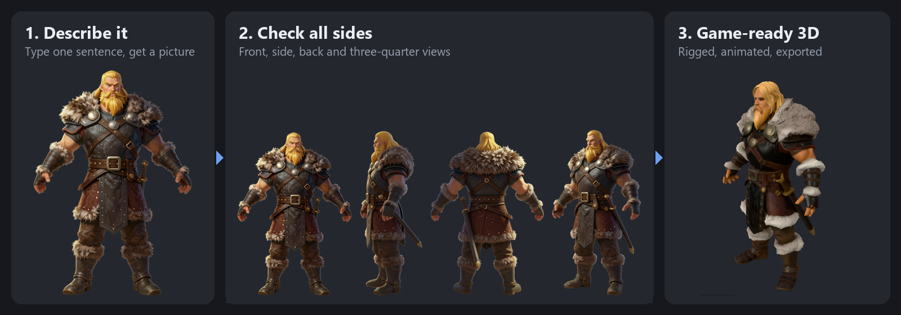
</p>

<p align="center">
  <a href="#install">Install</a> &nbsp;|&nbsp;
  <a href="#make-your-first-asset">Make your first asset</a> &nbsp;|&nbsp;
  <a href="#the-six-steps">The six steps</a> &nbsp;|&nbsp;
  <a href="#tips">Tips</a> &nbsp;|&nbsp;
  <a href="docs/ADVANCED.md">Advanced concepts</a>
</p>

---

## What it does

You describe a character, creature, prop or surface. The app paints a picture of it, draws it from every side, builds a 3D model from those pictures, cleans the model up, gives it a skeleton and walking and idle moves, and saves it in the formats game engines use.

What you get for each asset:

| | |
|---|---|
| **3D files** | FBX (Unity, Unreal, Godot), GLB (web, Blender) and a ready Unity prefab |
| **Textures** | Colour, bumps, shadowing, metal and shine maps |
| **Game parts** | Real-world size, lower-detail copies for distance (LODs), a collision shape |
| **Movement** | A skeleton, idle and walk moves, plus a library of 46 shared human moves for humanoids |

You stay in charge at every step: keep a result, try again, or describe a change in plain words. Or press one button and let **autopilot** run all six steps, stopping only when something needs you.

---

## Install

> **Short version:** install the four free tools below, run the setup helper, then double-click the VGAC shortcut.
> The full checklist, with every model file and licence, is in [docs/FIRST-TIME-SETUP.md](docs/FIRST-TIME-SETUP.md).

### What you need

| | Minimum | Notes |
|---|---|---|
| **Windows** | 10 (2004) or 11, 64-bit | |
| **Graphics card** | NVIDIA, 10 GB of graphics memory | Built and tested on 10 GB and 12 GB NVIDIA cards. Less than 10 GB is untested and may fail. Two cards is faster; one card works ([see Advanced](docs/ADVANCED.md#one-graphics-card)) |
| **Memory (RAM)** | 32 GB or more | With less than 64 GB, lower `min_free_ram_gb` ([see Advanced](docs/ADVANCED.md#settings-files)) |
| **Disk space** | About 150 GB free | The AI models are most of it |
| **Internet** | For the downloads only | After setup, the app works offline |

### Step 1. Install the basic tools

Install these four, each with its default options:

1. **NVIDIA graphics driver** from [nvidia.com/drivers](https://www.nvidia.com/drivers)
2. **Python 3.13** from [python.org](https://www.python.org/downloads/) (tick **"Add python.exe to PATH"** on the first screen)
3. **Node.js LTS** from [nodejs.org](https://nodejs.org/)
4. **Git** from [git-scm.com](https://git-scm.com/download/win)

### Step 2. Download the project

Open PowerShell in the folder where you want it and run:

```bash
git clone https://github.com/GuyThreepwood646/VideoGameAssetCreator.git
```

Then move into the new folder:

```bash
cd VideoGameAssetCreator
```

### Step 3. Run the setup check

This looks at your PC and prints a table of what is **Ready**, **Missing**, or **Needs you**. It changes nothing.

```bash
powershell -ExecutionPolicy Bypass -File setup\Check-Setup.ps1
```

Now let it set up the parts that live inside the project folder (the app's own Python and Node packages). It asks before every step.

```bash
powershell -ExecutionPolicy Bypass -File setup\Check-Setup.ps1 -Install
```

### Step 4. Install ComfyUI, Blender and Unity

These are the engines the app drives. Install them yourself:

| Tool | What it does in the app | Where to get it |
|---|---|---|
| **ComfyUI Desktop** | Runs the AI models (pictures, 3D, rigging) | [comfy.org](https://www.comfy.org/download) |
| **Blender 5.x** | Cleans up models, builds LODs, exports files | Step 5 can download it for you, or [blender.org](https://www.blender.org/download/) |
| **Unity Hub + Editor 6000.4.3f1** | Builds the ready-made Unity prefab | [unity.com/download](https://unity.com/download) (needs a free Unity account) |

### Step 5. Download the models and add-ons

A second helper offers each AI model, node pack, Blender and the optional animation packs as a pick list, showing the size and licence of each. Nothing downloads without your yes.

```bash
powershell -ExecutionPolicy Bypass -File setup\Setup-Extras.ps1 -Install -ComfyRoot "C:\path\to\your\ComfyUI"
```

`-ComfyRoot` is your ComfyUI folder: the one that holds `models` and `custom_nodes`.

> A few models have their own terms (Hunyuan3D, Anima, Gemma). The helper shows them and asks you to type a confirmation; it never accepts terms for you.

### Step 6. Point the app at your tools

The helper wrote suggested settings files next to the real ones, filled in with what it found on your PC. Open each `*.proposed.*` file, check it, and copy it over the real one:

| Suggested file | Copy it to |
|---|---|
| `backend\config.proposed.yaml` | `backend\config.yaml` |
| `desktop\config.proposed.json` | `desktop\config.json` |
| `runtime\start-comfy-b.proposed.ps1` | `runtime\start-comfy-b.ps1` |
| `runtime\start-comfy-a.proposed.ps1` (two cards only) | `runtime\start-comfy-a.ps1` |

What each setting means is in [Advanced: settings files](docs/ADVANCED.md#settings-files).

### Step 7. Start the app

Build the launcher and put a shortcut on your desktop (once):

```bash
cd desktop; npm run dist; powershell -ExecutionPolicy Bypass -File make-shortcut.ps1
```

From now on, **double-click VGAC on your desktop**. A small status window starts each service, then the app opens in its own window.

**Last check:** open **Health** in the top bar. The **"Is everything ready?"** box checks every model and node pack and tells you, in plain words, anything that is still missing.

<p align="center">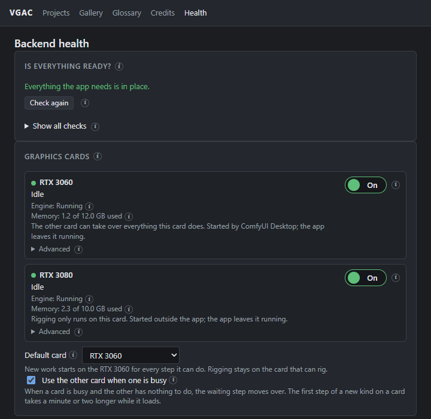</p>

---

## Make your first asset

A first run takes roughly 10 to 30 minutes depending on your graphics card and the size you pick. You can leave it running.

### 1. Create a project

A project is one game, or one art style. Every asset in it shares the same **look**, so they match.

On the **Projects** page, click **New project**. Give it a name, pick the **platform** (Phone, PC and console, and so on: this sets how detailed the models are) and pick a **look**.

<p align="center">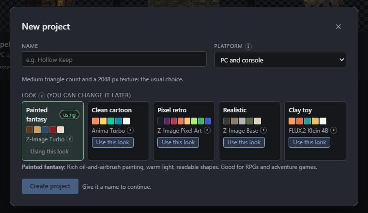</p>

### 2. Describe your asset

Inside the project, fill in the **New asset** box on the right:

- **Prompt.** One sentence: what it is, two or three things you can see, the colours. For example: *"A stylized fantasy viking warrior, a broad man with a thick blond beard and long blond hair, fur-trimmed leather armour."*
- **What is it.** Humanoid, quadruped, rigid prop, material and so on. This decides whether it gets a skeleton.
- **Build it automatically after creating.** Leave this ticked to run every step by itself.

Click **Create and make it**.

<p align="center">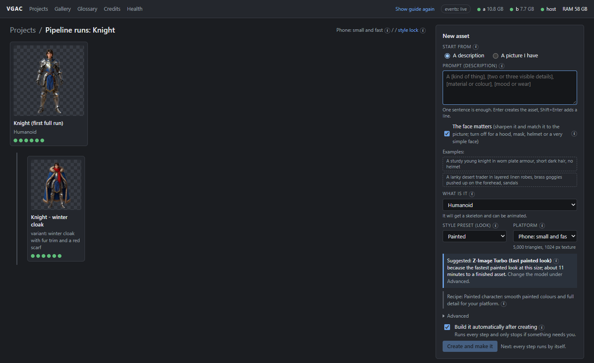</p>

> Already have a picture? Choose **Start from: A picture I have** and drop it in. One subject on a plain background, whole body in view, works best.

### 3. Watch it build

The asset page opens. The six steps are listed on the left; a green dot means a step is done and kept. The banner at the top always says what is happening and what, if anything, it needs from you.

<p align="center">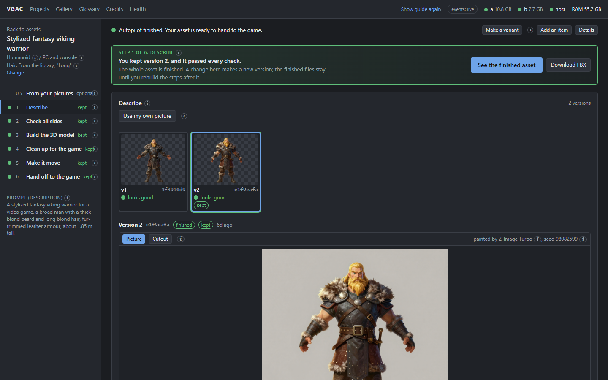</p>

### 4. Review, keep, or change

Under every result is a **"Happy with this?"** bar:

| Button | What it does |
|---|---|
| **Keep** | Use this version. Later steps build on it |
| **Try again** | Make new versions from scratch (pick how many) |
| **Change something** | Describe a change in words, such as *"make the helmet open-faced"*, or fine-tune the settings |
| **Thumbs up / down** | Tell the app what you liked, so it can suggest better settings later. Stays on your PC |

Nothing is ever lost. Every try is kept as a version you can go back to.

<p align="center">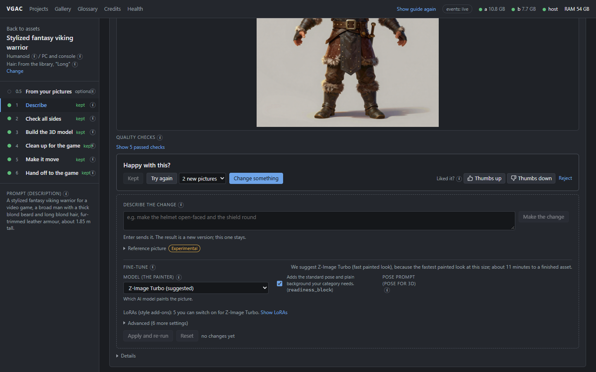</p>

### 5. Get your files

When the last step finishes, the page shows **Your asset is ready** with a moving preview and a checklist of what you got.

<p align="center">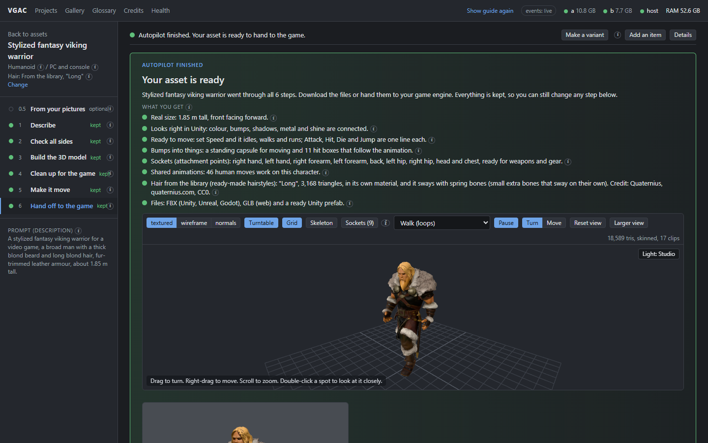</p>

- Click **FBX** or **GLB** to download, or **Download FBX** at the top of any step.
- Every finished asset is also saved to `exports\<project>\<asset>\` inside the project folder, with its textures and a `manifest.json`.
- The **Gallery** page lists every finished asset, with a **Copy** button for its folder.

<p align="center">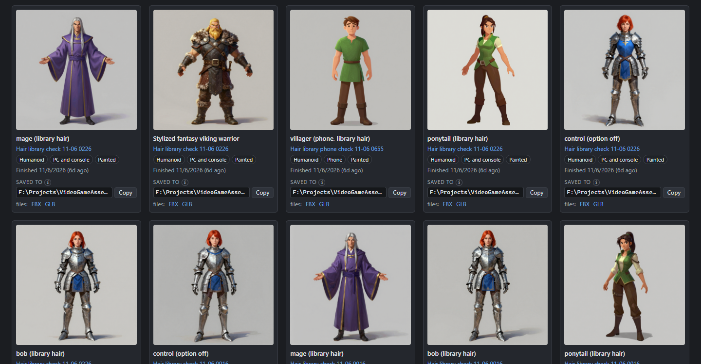</p>

---

## The six steps

Click any step on the left of the asset page to open it. Each one shows its result, the checks it ran, and the same Keep / Try again / Change something bar.

<table>
<tr>
<td width="50%" valign="top">

**1. Describe**<br>
Paints a picture of your asset in the project's look and cuts it out of the background.

</td>
<td width="50%" valign="top">

**2. Check all sides**<br>
Draws the front, both sides, the back and a three-quarter view, and checks they all match the front. Tick any view that looks wrong to redraw just that one.

</td>
</tr>
<tr>
<td></td>
<td>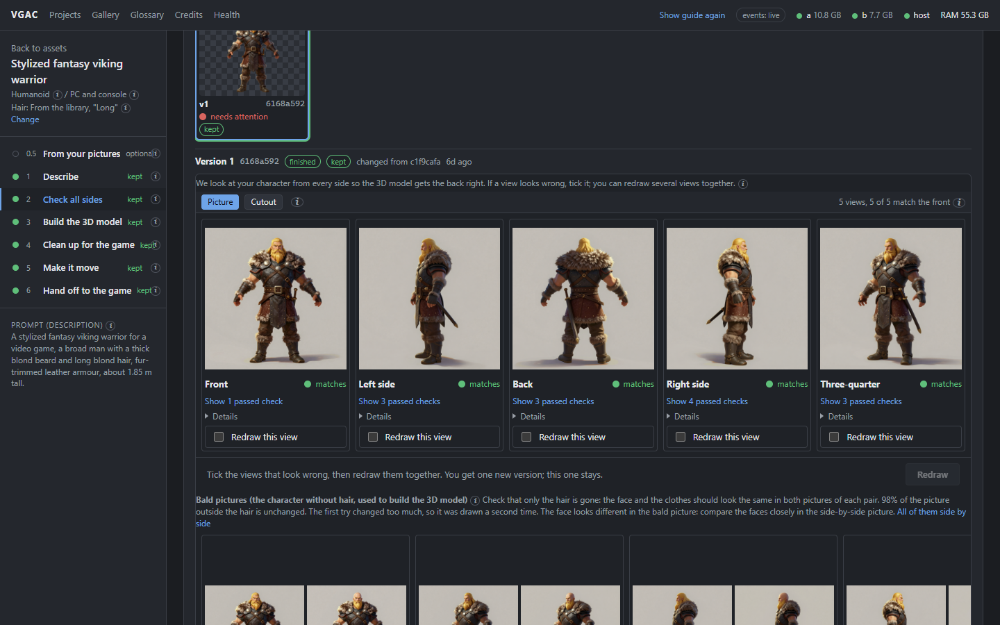</td>
</tr>
<tr>
<td width="50%" valign="top">

**3. Build the 3D model**<br>
Turns the pictures into a textured 3D model sized for your platform. Drag to turn it, scroll to zoom, and switch between textured, wireframe and normals.

</td>
<td width="50%" valign="top">

**4. Clean up for the game**<br>
Sets the real-world size, puts the pivot at the feet, fixes holes, sharpens the face and fits the hair.

</td>
</tr>
<tr>
<td>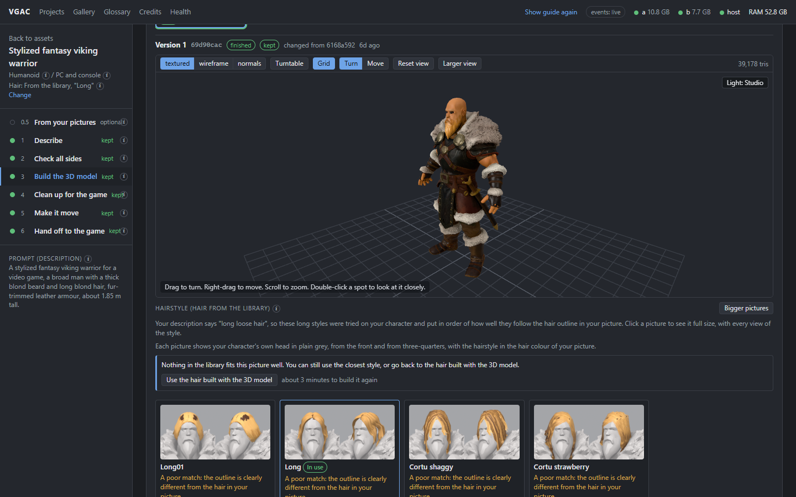</td>
<td>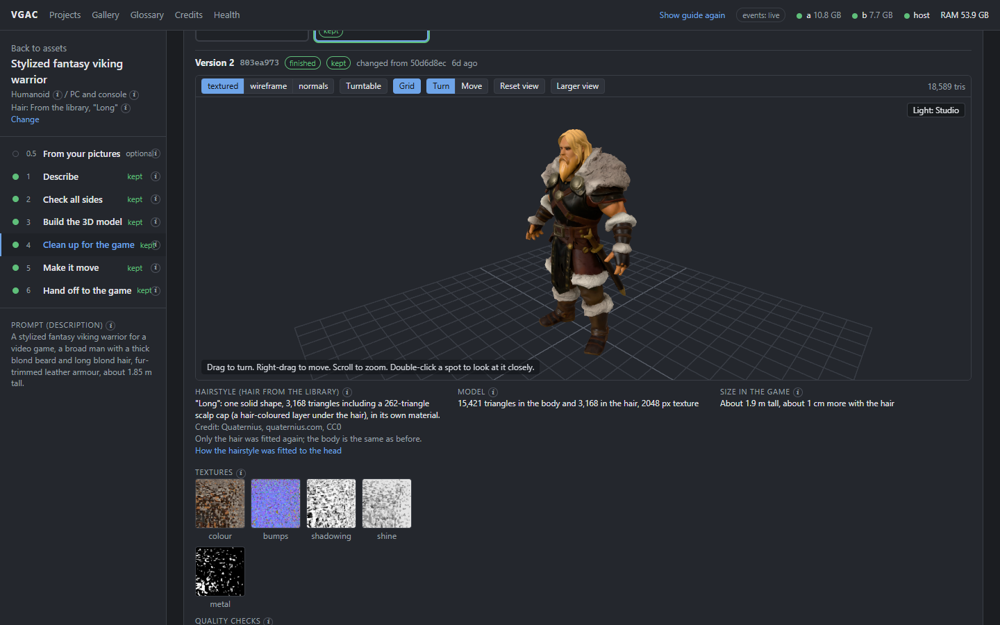</td>
</tr>
<tr>
<td width="50%" valign="top">

**5. Make it move**<br>
Adds a skeleton, tests that the joints bend cleanly, and attaches moves (idle, walk, run, attack and more). Use **Add a move** to pick more. Rigid props skip this step.

</td>
<td width="50%" valign="top">

**6. Hand off to the game**<br>
Builds lower-detail copies, a collision shape and the final FBX and GLB, imports it into Unity to make a prefab, and runs the final quality checks.

</td>
</tr>
<tr>
<td>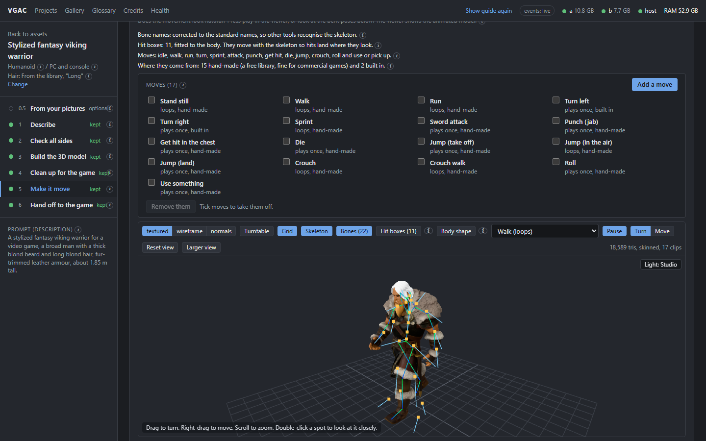</td>
<td></td>
</tr>
</table>

---

## Tips

- **Hover any small "i"** for a plain explanation of that word or setting. The **Glossary** in the top bar lists them all.
- **Make a variant** (top of the asset page) makes a copy with one change, such as *"winter cloak with fur trim"*, that still looks like the same character.
- **Add an item** makes a sword, shield, bow or backpack as its own asset and attaches it to the character, so it can really hold it in your game.
- **Show guide again** (top bar) reopens the three-step introduction.
- **The dots in the top bar** show whether each engine (the two graphics cards and the host PC) is reachable. Green means ready.
- **A step says "needs attention"?** Open it: the checks say what failed and usually offer a one-click fix.
- **Something slow or stuck?** Open **Health**. It shows each graphics card, what it is doing, and lets you switch a card off.

---

## Going further

[**Advanced concepts**](docs/ADVANCED.md) covers the deeper configuration:

- [How the app is put together](docs/ADVANCED.md#how-the-app-is-put-together) (the services and the two graphics cards)
- [Settings files](docs/ADVANCED.md#settings-files) (paths, ports, memory floor, which card runs which step)
- [One graphics card](docs/ADVANCED.md#one-graphics-card)
- [Styles, models and add-ons](docs/ADVANCED.md#styles-models-and-add-ons)
- [What each step does under the hood](docs/ADVANCED.md#what-each-step-does-under-the-hood)
- [Sending assets straight into a Unity project](docs/ADVANCED.md#sending-assets-straight-into-unity)
- [Running from source, mock mode and tests](docs/ADVANCED.md#running-from-source)
- [The API](docs/ADVANCED.md#the-api)

Other documents: [ARCHITECTURE.md](ARCHITECTURE.md) (how the application is built), [docs/API.md](docs/API.md) (the full API contract), [docs/BACKEND.md](docs/BACKEND.md) (backend code map), [docs/BUILD-THE-EXE.md](docs/BUILD-THE-EXE.md) (building the launcher).

---

## Licence

Copyright (C) 2026 Runtime Forge LLC. Free software under the GNU General Public License, version 3 or (at your option) any later version; see [LICENSE](LICENSE).

The few files the app copies into your Unity project (the importer, the spring-bone script and the hair shaders) are MIT instead, so they never put your game under the GPL. AI models are never bundled: each is downloaded from its original source under its own licence. Credits for the projects this builds on are in [CREDITS.md](CREDITS.md) and [THIRD-PARTY-NOTICES.md](THIRD-PARTY-NOTICES.md).
